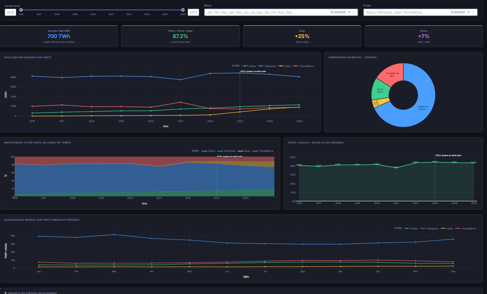
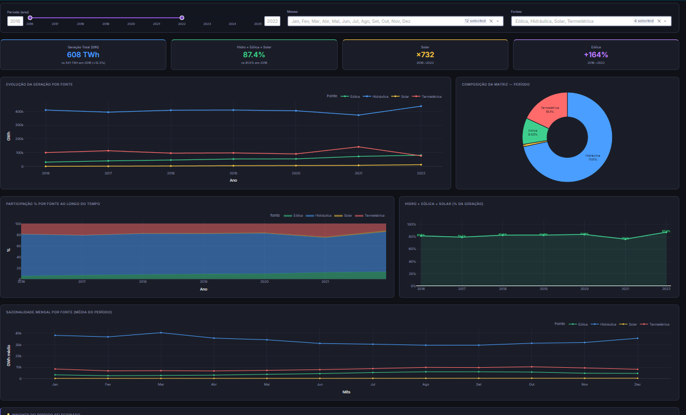

# ⚡ Brazilian Energy Matrix — Dashboard on ONS Open Data


## 📌 Overview

Interactive dashboard on Brazil's electricity generation by source (hydro, thermal, wind, solar), built from the **hourly** "Balanço de Energia nos Subsistemas" dataset published by ONS (the national grid operator). It covers the **complete years 2016–2025**.

This is a portfolio project, not a production system. It was built to show a traceable data path (public source → warehouse → tested transformations → dashboard) and to be honest about what the data can and cannot support. The [Limitations](#️-limitations) section is part of the project, not a footnote.




---

## 🔗 Where the data comes from

```
ONS open data (hourly, S3)
   └─► ons-energy-pipeline  (Python load → BigQuery raw → dbt staging → dbt mart, monthly GWh)
          └─► src/ingestao.py        → data/raw/ons_geracao_mensal.parquet  (+ manifest with SHA-256)
                 └─► src/transformacao.py → data/processed/*               (+ manifest)
                        └─► dashboard/app.py
```

The warehouse side lives in the companion repo [ons-energy-pipeline](https://github.com/carlosMartinez93/ons-energy-pipeline), which loads the same ONS dataset into BigQuery and models it with dbt (with tests and CI). This repo starts from its monthly mart.

Every data file has a `.manifest.json` next to it recording where it came from. **The dashboard refuses to start** on data without a manifest of origin `ons_bigquery`, and `transformacao.py` refuses a raw file whose hash no longer matches its manifest. There is no demo-data fallback: `python src/ingestao.py --synthetic` writes random development data to `data/dev/` (git-ignored), and the dashboard never reads it.

---

## 🗂️ Project Structure

```
brazil-energy-matrix/
├── data/
│   ├── raw/             # monthly generation by subsystem, as extracted (+ manifest)
│   ├── processed/       # outputs of transformacao.py (+ manifest)
│   └── reference/       # official figures used to cross-check the data
├── src/
│   ├── ingestao.py      # BigQuery → data/raw (blocks on null hours in the 4 subsystems)
│   ├── transformacao.py # complete years only, national total, reconciliation, series-break handling
│   ├── regimes.py       # rule for which year-to-year comparisons are valid
│   ├── proveniencia.py  # manifests and hash checks
│   └── validacao.py     # compares the data with the official figure → docs/validacao.md
├── dashboard/app.py     # Plotly Dash app
├── sql/queries_energia.sql
├── tests/               # pytest (logic on small fabricated data + checks on the real files)
├── docs/                # validacao.md and screenshots
├── .github/workflows/ci.yml
├── requirements.txt     # pinned runtime dependencies
└── requirements-dev.txt # + pytest, ruff
```

---

## 🛠️ Tech Stack

| Layer | Technology |
|-------|-----------|
| Source / warehouse | ONS open data → BigQuery + dbt (in [ons-energy-pipeline](https://github.com/carlosMartinez93/ons-energy-pipeline)) |
| Ingestion | Python, `google-cloud-bigquery` |
| Transformation | pandas, pyarrow (Parquet) |
| Visualization | Plotly Dash + Bootstrap |
| SQL | Standard SQL over the processed Parquet files (queries checked in DuckDB) |
| Quality | pytest, ruff, GitHub Actions |

---

## 🚀 How to Run

Python 3.12 is what CI uses. The processed data is committed, so you can open the dashboard without any cloud access.

```bash
git clone https://github.com/carlosMartinez93/brazil-energy-matrix.git
cd brazil-energy-matrix
python -m venv .venv
source .venv/bin/activate          # Windows: .venv\Scripts\activate
pip install -r requirements.txt

python dashboard/app.py            # http://localhost:8050
```

**Refreshing the data** (needs Google Cloud access to the BigQuery table built by the companion repo):

```bash
gcloud auth application-default login
python src/ingestao.py             # BigQuery → data/raw
python src/transformacao.py        # data/raw → data/processed
python src/validacao.py            # re-generates docs/validacao.md
```

**Tests and lint:**

```bash
pip install -r requirements-dev.txt
ruff check .
pytest -q
```

---

## 📊 Dashboard Features

- **Filters:** period (defaults to the full range), months, and sources.
- **KPIs:** total generation, Hydro+Wind+Solar share, and Solar / Wind variation. All four cards compare the same two years: the longest window that does not cross the 2023 series break (2024→2025 with the default period). If there is no valid window they show `n/d` and say why. The insights box keeps the long Wind history (2016→2025) with its years written out.
- **Charts:** generation by source per year, composition of the period, share-of-generation area chart, Hydro+Wind+Solar share, monthly seasonality.
- **Insights** generated from the filtered data, with the scope caveats attached.
- A marker at **2023** on the year charts flags the solar series break described below.

---

## 💡 Key Findings

Computed from the processed files in `data/processed/`, comparing only years inside the same series regime (see Limitations).

| | Finding |
|---|---|
| Wind | 30.7 TWh (2016) → 115.4 TWh (2025). |
| Solar | 2024 → 2025: 73.3 → 91.8 TWh (+25%). Before the break, 2016 → 2022: 0.02 → 12.1 TWh. |
| Hydro | Largest source in every year; 57.7% of generation in 2025. In 2021 its share dropped to 62.7% (thermal rose to 23.9%). |
| Hydro + Wind + Solar | 81.5% (2016) → 87.4% (2022), then 87.7% (2024) and 87.2% (2025). |
| Total generation | 695.0 TWh (2024) → 700.4 TWh (2025), about +0.8%. |

---

## ⚠️ Limitations

- **Break in the solar series (May 2023).** Monthly solar generation jumps by +140.8% from April to May 2023; in every other year the May/April ratio is between 0.95 and 1.26, except 2017 (4.96, the early ramp from a very small base). A likely cause is the ONS starting to include an estimate of distributed generation (MMGD), but I could not confirm that in the dataset documentation, so it is a hypothesis. Consequence: **solar growth, total-generation growth and source shares are only compared inside 2016–2022 or inside 2024–2025.** 2023 is treated as a transition year. Wind does not show the same jump. The evidence is stored in the manifest (`quebra_de_serie`), and a test enforces that no solar year-over-year figure crosses it.
- **Scope is the operational grid (SIN), not the whole country.** It can differ from national energy balances.
- **Only four sources.** The ONS dataset separates hydro, thermal, wind and solar. Biomass and nuclear are inside thermal, so the app says "Hydro+Wind+Solar" and not "renewable".
- **External validation covers one year.** For 2024, the project total is 695.0 TWh against 687.7 TWh in the MME annual bulletin (+1.06%). The cause of the gap is not established, so it is reported and not adjusted. Other years have no verified official reference yet. Details in [docs/validacao.md](docs/validacao.md).
- **Internal check:** the sum of the 4 subsystems against the national total published by ONS differs by at most 0.51% across 143 months.
- **Years left out:** 2015 (one day missing for the North subsystem in April 2015) and 2026 (partial year).
- Not production: no scheduled refresh, no deployment, no forecasting.

---

## 🗃️ Included SQL Analyses

`sql/queries_energia.sql` (standard SQL over the Parquet files; all queries run in DuckDB):

- Total generation by source and year with percentage share
- Hydro + Wind + Solar share over time
- Year-over-year growth by source (solar returns `NULL` for 2023 and 2024, see Limitations)
- Wind and solar highlighted
- Source ranking for the latest year
- Hydro vs. new renewables
- Monthly seasonality by source

---

## 📁 Generated Data

| File (in `data/processed/`) | Description |
|------|-------------|
| `geracao_completa.parquet` | National monthly generation by source (sum of the 4 subsystems) |
| `geracao_mensal_subsistema.parquet` | Same, by subsystem |
| `geracao_anual_por_fonte.parquet` / `.csv` | Annual totals and share by source |
| `mix_hidro_eolica_solar_anual.parquet` / `.csv` | Hydro+Wind+Solar share by year |
| `crescimento_solar_eolica.parquet` | Monthly series with YoY variation (empty where it would cross the solar break) |
| `reconciliacao_sin.parquet` | Sum of subsystems vs. the ONS national total, month by month |

---

## 📌 Next Steps

- [ ] Find official references for more years than 2024 and extend the external check
- [ ] Confirm the cause of the 2023 solar break with ONS documentation
- [ ] Investigate the +1.06% gap against the MME figure
- [ ] Climate data (precipitation) to relate to hydro variation

---

## 👤 Author

**Carlos Henrique** — Analytics Engineer

[](https://www.linkedin.com/in/carlos-henrique-calvo-martinez-044ab9124/)
[](https://github.com/carlosMartinez93)

---

## 📄 License

MIT License — free to use, adapt, and distribute with attribution.
